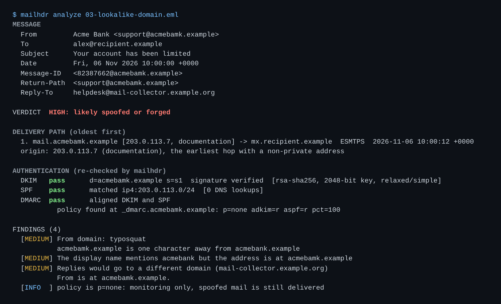
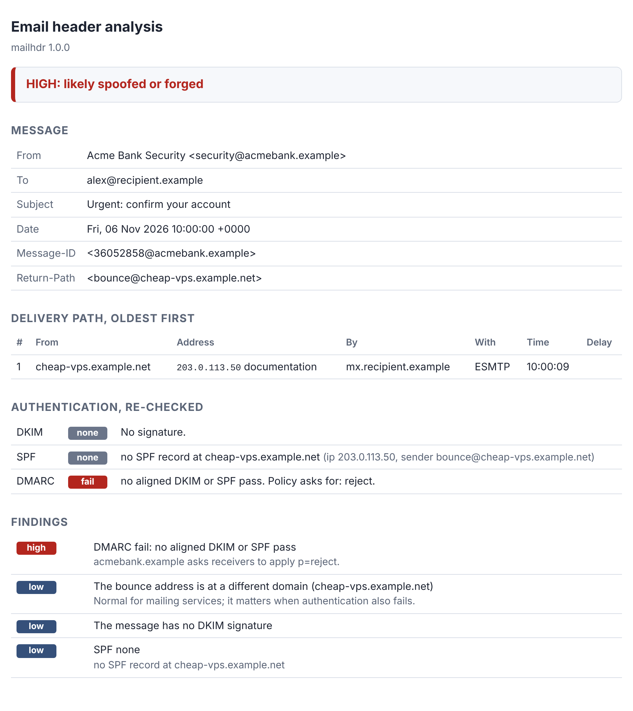

# mailhdr

[](https://github.com/TexAlphaWolf/sec-email-header-analyzer/actions/workflows/ci.yml)
[](https://github.com/TexAlphaWolf/sec-email-header-analyzer/actions/workflows/codeql.yml)


Give it a saved email (`.eml`). It rebuilds the **delivery path** from the Received headers, **re-checks SPF, DKIM and DMARC itself** instead of trusting what the message says about itself, and lists the **signs of spoofing**: look-alike domains, display-name tricks, a Reply-To that goes elsewhere, a forged `Authentication-Results`, clocks that run backwards.



*A made-up message (all names are fictional). Every check passes, because the attacker set up their own domain properly, and it is still flagged HIGH.*

DKIM (RSA and Ed25519), SPF and DMARC are implemented here, not wrapped: the signature maths is plain Python integers, and everything above the DNS lookup runs offline. One dependency, `dnspython`, for the lookups.

## Use it

```bash
pip install .
mailhdr analyze message.eml                      # text report, real DNS
mailhdr analyze message.eml --format html -o report.html
mailhdr analyze message.eml --format json
mailhdr analyze message.eml --offline            # no DNS: only headers and the path
mailhdr analyze message.eml --zone saved.json    # DNS answers from a file (reproducible)
cat message.eml | mailhdr analyze -
```

Try the six sample messages in `examples/` (fictional names, documentation IP ranges):

```bash
mailhdr analyze examples/02-spoofed-sender.eml --zone examples/zone.json --brands examples/brands.txt
```

Useful options: `--ip`, `--helo`, `--mailfrom` (what SPF should check, when the defaults are wrong), `--brands FILE` (domains to guard against look-alikes), `--fail-on medium|high` (exit status 1 for a pipeline), `--dns-server IP`. Exit status 2 means the input could not be read.

With Docker, nothing is installed on the machine:

```bash
docker build -t mailhdr .
docker run --rm -v "$PWD:/mail:ro" mailhdr analyze /mail/message.eml
```

Use the message's original source ("show original" in Gmail, "view source" in Thunderbird): forwarding or re-saving can change bytes and break DKIM for innocent reasons.



## What it checks

- **Path:** every Received header (from, by, protocol, time), oldest first, with the delay at each hop, the earliest non-private address, clocks going backwards, hops that took over an hour, and a server that says it received from someone other than the previous hop.
- **DKIM** (RFC 6376, 8301, 8463): both canonicalisations, `l=`, header selection from the bottom, `rsa-sha256` and `ed25519-sha256`; `rsa-sha1` and keys under 1,024 bits are refused by policy; weak 1,024-bit keys, test keys and body-length limits are flagged.
- **SPF** (RFC 7208): all mechanisms, macros, the 10-lookup and 2-void-lookup limits, `redirect`, `exp`.
- **DMARC** (RFC 7489): policy at the domain or its organisational domain (bundled Public Suffix List), strict and relaxed alignment, `p`, `sp`, `pct`.
- **Spoofing signs:** [the full list](docs/findings.md), each with a severity. The verdict (LOW, MEDIUM, HIGH) adds them up.

## Measured

Every number comes from a script in this repository that CI re-runs. Details, and the differences these runs found: [docs/evaluation.md](docs/evaluation.md).

| What | Result |
|---|---|
| DKIM: 150 messages signed by `dkimpy` in 4 canonicalisation modes, undamaged and damaged 5 ways, verdict compared | **900 of 900 agree** |
| Ed25519 and RSA (1,024 to 4,096 bits) signatures made by `cryptography`, good and corrupted | 200 of 200 and 160 of 160 correct |
| SPF: 252 random zones, 6 client addresses each, compared with `pyspf` | **1,512 of 1,512 agree** (48 zones with a self-include set aside, see [evaluation](docs/evaluation.md)) |
| Public Suffix List matcher, the list's own conformance file | 78 of 78 |
| 5,000 damaged messages through the whole analysis | 0 crashes |
| Time for the whole analysis of one message (DNS from a file) | about 0.8 ms |
| Tests | 506 (31 skip by design), coverage above 90% (enforced) |

## What it is not

It cannot prove a message genuine or forged: it reports signs. DNS is read as it is **now**, so an old message can fail because a key was rotated. The connecting IP SPF needs is, unless you give `--ip`, a guess from the topmost Received header, and the output says so. Look-alike detection is a heuristic with a short brand list. No ARC, BIMI or DNSSEC. More in [docs/limitations.md](docs/limitations.md).

## Docs

- [Findings](docs/findings.md): every sign it reports, and how the verdict is made
- [Evaluation](docs/evaluation.md): what was measured and what the tests found
- [Limitations](docs/limitations.md)
- [Security policy](SECURITY.md), [Contributing](CONTRIBUTING.md), [Changelog](CHANGELOG.md)

Reports contain addresses and host names from the message; look before you share one. The Public Suffix List (`src/mailhdr/data/`) is Mozilla's, under MPL-2.0.

## License

MIT, Luca Tessitore (the bundled Public Suffix List keeps its MPL-2.0 licence)
